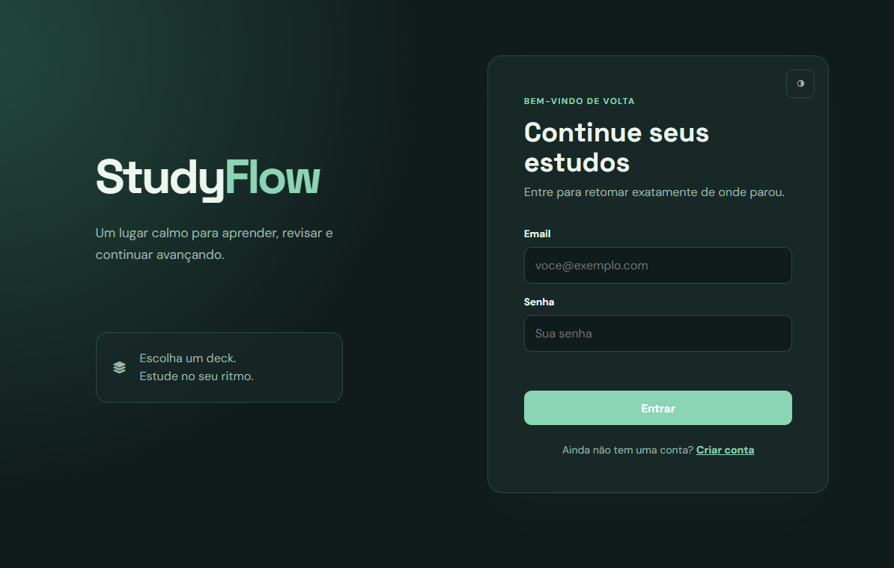
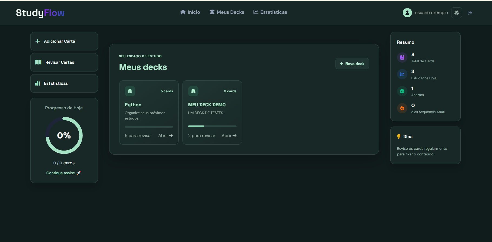

# Study cards

Aplicação de flashcards com FastAPI e frontend estático.

## Requisitos

- Python 3.10+
- pip
- Git (opcional)

## 1) Clonar o projeto

```bash
git clone <url-do-repositorio>
cd novo_crud
```

## 2) Criar e ativar o ambiente virtual

No PowerShell:

```powershell
python -m venv venv
.\venv\Scripts\Activate.ps1
```

Se o ambiente estiver já criado, basta ativar:

```powershell
.\venv\Scripts\Activate.ps1
```

## 3) Instalar dependências

```powershell
pip install -r requirements.txt
```

## 4) Executar a aplicação

No diretório raiz do projeto:

```powershell
uvicorn app.main:app --reload
```

A API ficará disponível em:

- http://127.0.0.1:8000
- http://localhost:8000

O frontend também é servido pela própria aplicação, então ao abrir a rota raiz do projeto no navegador, a interface será carregada automaticamente.

## 5) Acessar o projeto no navegador

Abra no navegador:

```text
http://localhost:8000
```

## 6) Dicas

- Para encerrar o servidor: `Ctrl + C`
- Se precisar reinstalar dependências, rode novamente:

```powershell
pip install -r requirements.txt
```

## Estrutura principal

```text
app/
  routes/
  models.py
  schemas.py
  main.py
frontend/
  ...
```




